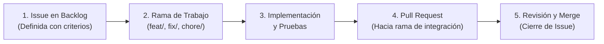

# Marco de Trabajo: Scrumban y Flujo en GitHub

Este documento describe la metodología ágil y el flujo operativo oficial para el equipo de desarrollo de **Villa Serena**. 

---

## 1. Filosofía de Trabajo (Scrumban)

Para equilibrar la necesidad de entregas planificadas con la agilidad requerida en el desarrollo del sistema, adoptamos un enfoque **Scrumban** (combinación de Scrum y Kanban):

* **Cadencia por Sprints (Scrum):** El trabajo se organiza en iteraciones orientadas a completar versiones funcionales e incrementales (`v0.1.0 MVP`, `v0.2.0 Operativa`, `v0.3.0 Integral`).
* **Flujo Continuo (Kanban):** El estado del día a día se gestiona mediante el tablero de **GitHub Projects**, limitando el trabajo en progreso (WIP) para evitar la sobrecarga y el caos.

La rama de integración depende del repositorio: docs utiliza `main`; API y web usan sus ramas acordadas (`dev` o `develop`). Consulta `AGENTS.md` y [CONTRIBUTING.md](../CONTRIBUTING.md).

### Roles del Equipo
* **Product Owner (Kimberly):** Define las prioridades del Product Backlog, evalúa el alcance funcional y tiene la decisión final sobre los criterios de aceptación del producto.
* **Scrum Master (Alex):** Facilita el proceso de desarrollo, gestiona los cuellos de botella y apoya la resolución de bloqueos técnicos y de coordinación.
* **Equipo de Desarrollo (Josué, Carlos, Pablo, Hugo, Alex, Kimberly):** Diseña, implementa y verifica las soluciones técnicas con autonomía dentro del alcance acordado.

---

## 2. El Ciclo de Vida del Trabajo en GitHub

**La única fuente de verdad operativa es GitHub.** Ninguna línea de código se escribe sin estar respaldada por el siguiente flujo:

### Paso 1: Selección de la Issue
1. El desarrollador toma una issue asignada o disponible en el tablero de GitHub Projects y la mueve a la columna **In Progress**.
2. Cada issue debe describir claramente el problema a resolver o la funcionalidad esperada junto a sus **criterios de aceptación**.

### Paso 2: Creación de la Rama de Trabajo
Las ramas de trabajo parten de la rama de integración del repositorio (`main` en docs) y siguen la convención de nombres:
* `feat/<numero-issue>-<descripcion-corta>` (para nuevas funcionalidades)
* `fix/<numero-issue>-<descripcion-corta>` (para corrección de bugs)
* `chore/<numero-issue>-<descripcion-corta>` (para tareas de mantenimiento, dependencias o documentación)
* `refactor/<numero-issue>-<descripcion-corta>` (para reestructuración de código sin cambio funcional)

### Paso 3: Implementación y Pruebas
* **Autonomía técnica:** Los detalles técnicos rutinarios (ajustes de librerías, tipados, estructura interna) se resuelven con criterio del desarrollador.
* **Cambios de alcance:** Si durante la implementación se detecta que una regla o requisito no tiene sentido técnico o es desproporcionadamente complejo, **no se bloquea el desarrollo**: se registra una consulta o propuesta en la issue para validación de la Product Owner.

### Paso 4: Pull Request hacia la rama de integración
* La PR se dirige a la rama acordada del repositorio: `main` en docs, `dev` o `develop` en los repositorios de código según sus instrucciones.
* En los repositorios de código, `main` conserva su papel de entrega; no se aplica esa restricción a las PR de docs.
* La PR debe titularse con claridad, describir qué problema resuelve, cómo se probó y referenciar la issue con `Closes #XX`.

### Paso 5: Revisión e Integración
* Una vez revisada y con las pruebas automáticas o verificaciones en verde, la PR se fusiona en la rama de integración y la issue se cierra cuando cumple sus criterios. Si la rama no es la predeterminada, se comprueba el cierre explícitamente.

---

## 3. Definición de Hecho (Definition of Done - DoD)

Una tarea o issue se considera **terminada (Done)** únicamente cuando cumple con los siguientes criterios:

1. **Funcionalidad verificada:** Cumple con los criterios de aceptación especificados en la issue.
2. **Sin errores de compilación ni regresiones:** El código compila limpiamente y no rompe los tests existentes (`mvn test`, `pnpm build`, `pnpm lint`).
3. **Seguridad y secretos:** No se incluyen credenciales, contraseñas, tokens de API ni variables de entorno sensibles en los commits.
4. **Documentación de la PR:** La descripción de la PR resume el cambio realizado y documenta cualquier detalle no obvio para el resto del equipo.
