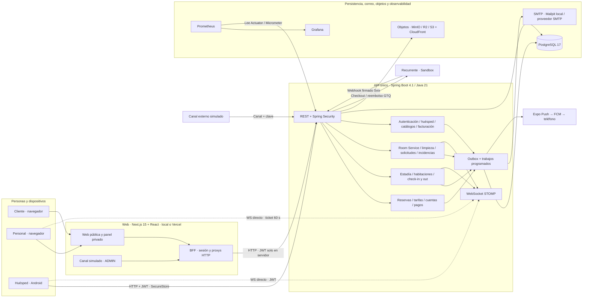

# 01 — Componentes y conexiones

**Vista:** Componentes · **Alcance del plan:** Hito.

Quién llama a quién, dónde se deciden las reglas y cuáles servicios son externos.

## Reglas y límites

- Los recuadros dentro de Spring son módulos de un solo API, no microservicios.
- En local, PostgreSQL 17, Mailpit, MinIO, Prometheus y Grafana corren en Docker Compose; en despliegue compartido, la web corre en Vercel y el API detrás de AWS HTTP API Gateway + EC2 ARM64 + S3 + CloudFront.
- El contrato canónico vive en [`villa-serena-docs/openapi.yaml`](../../openapi.yaml) y cada consumidor fija su revisión en `api-contract.json` ([guía del contrato](../contrato-api.md)).

## Referencias

- [Arquitectura del sistema §§2–6](../arquitectura-sistema.md)
- [Despliegue y modelo de datos](../../04-guias-y-referencia/despliegue-y-modelo-datos.md)
- [Matriz de permisos §§5–7](../../02-producto/matriz-de-permisos.md)
- [Integración con canales §2](../../04-guias-y-referencia/integracion-canales.md)

[Índice de diagramas](README.md) · [Cobertura de historias](COBERTURA.md) · [Siguiente](02-participantes-y-responsabilidades.md)
