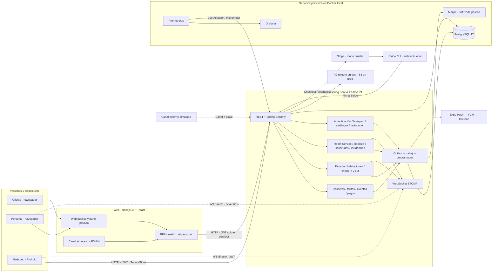

# 01 — Componentes y conexiones

**Vista:** Componentes · **Alcance del plan:** Hito.

Quién llama a quién, dónde se deciden las reglas y cuáles servicios son externos.

Almacenamiento actualizado por [ADR-007](../adr/ADR-007-almacenamiento-r2-s3.md); los demás componentes del diagrama conservan su alcance de plan.

## Reglas y límites

- Los recuadros dentro de Spring son módulos de un solo API, no microservicios.
- El Docker local está previsto por la documentación; este atlas no afirma que esté disponible.
- El contrato está en api/openapi.yaml; web y app generan sus tipos por separado.

## Referencias

- [14 §§2–6](../arquitectura-sistema.md#2-decisiones-de-arquitectura)
- [09 §§5–7](../../02-producto/matriz-de-permisos.md#5-actores-que-no-son-usuarios)
- [19 §2](../../04-guias-y-referencia/integracion-canales.md#2-qué-hace-hoy-el-sistema)

[Índice de diagramas](README.md) · [Cobertura de historias](COBERTURA.md) · [Siguiente](02-participantes-y-responsabilidades.md)
