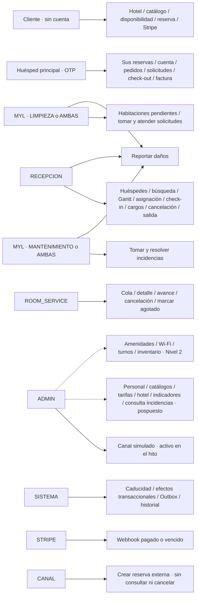

# 02 — Participantes y responsabilidades

**Vista:** Participantes · **Alcance del plan:** Mixto.

Cliente y huésped pueden ser la misma persona; sus accesos y permisos son diferentes.

## Reglas y límites

- MYL es un rol con áreas LIMPIEZA, MANTENIMIENTO o AMBAS.
- ADMIN no hereda permisos de Recepción, Room Service ni piso.
- Administración está documentada como Nivel 1, pero pospuesta del hito por el plan.

## Referencias

- [02](../../02-producto/roles-y-responsabilidades.md#2-resumen-de-roles)
- [09 §§3–6](../../02-producto/matriz-de-permisos.md#3-matriz-por-módulo)
- [12 §2](../../02-producto/casos-de-uso.md#2-actores)
- [Roadmap por versiones](../../01-metodologia/roadmap-versiones.md#1-resumen-de-fases) (vigente) y [13 §9 del plan original archivado](../../04-guias-y-referencia/historico/plan-de-trabajo-original.md#9-orden-de-recorte)

[Índice de diagramas](README.md) · [Cobertura de historias](COBERTURA.md) · [Anterior](01-componentes-y-conexiones.md) · [Siguiente](03-actividad-general-de-la-reserva-a-la-siguiente-llegada.md)
