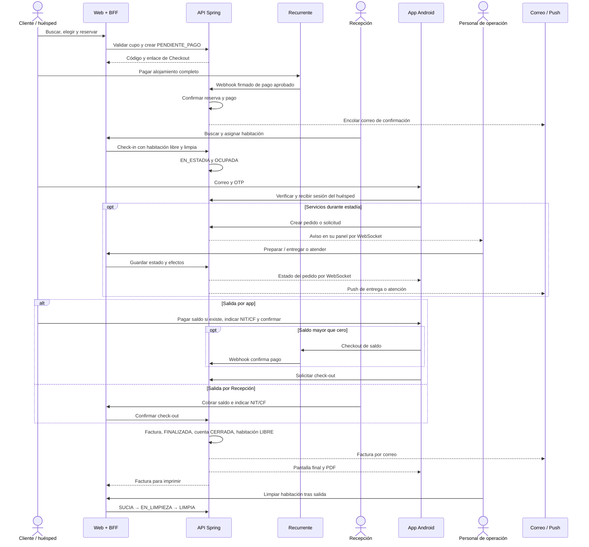

# 04 — Secuencia general del viaje del huésped

> Reconciliación 22/10/2026: [flujos y decisiones actuales](../../02-producto/reconciliacion-frontend-20261022.md). El nombre histórico del archivo se conserva. El portal web complementa Android; el retorno no confirma pagos y subir documentos no realiza check-in.

**Vista:** Secuencia · **Alcance del plan:** Hito.

Una vista temporal compacta de la experiencia completa y sus participantes.

## Reglas y límites

- Los mensajes resumen casos de uso; no son una lista exhaustiva de endpoints.
- La operación del personal y del portal web del huésped pasa por el BFF. Esta secuencia representa Android para la estadía: solo ese cliente llama directamente al API y usa push Expo; no excluye el portal web.

## Referencias

- [01 §4](../../02-producto/alcance-y-decisiones.md#4-flujo-principal-del-sistema)
- [12 UC-02,03,04,06,11,13,20](../../02-producto/casos-de-uso.md#3-mapa-de-casos-de-uso)

[Índice de diagramas](README.md) · [Cobertura de historias](COBERTURA.md) · [Anterior](03-actividad-general-de-la-reserva-a-la-siguiente-llegada.md) · [Siguiente](05-actividad-disponibilidad-y-tarifa.md)
