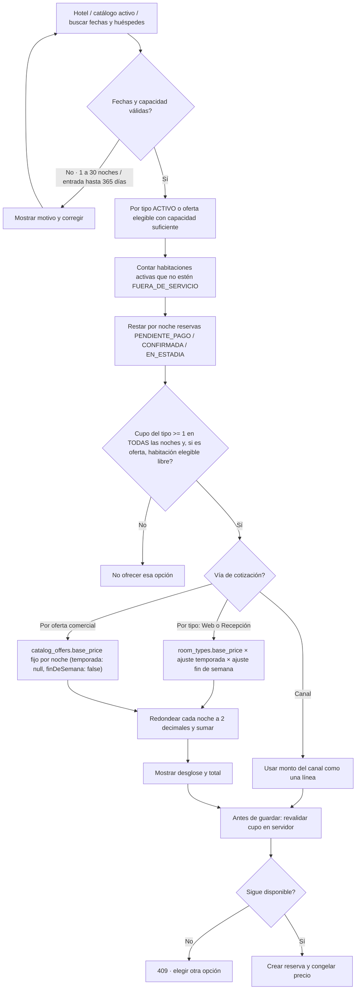

# 05 — Actividad: disponibilidad y tarifa

**Vista:** Actividad · **Alcance del plan:** Hito.

El mismo cálculo de cupo por tipo sirve a web (`/api/v1/publico/disponibilidad`), Recepción y canal; las ofertas comerciales (`/api/v1/publico/ofertas/disponibilidad`) exigen además al menos una habitación elegible libre en `catalog_offer_rooms` y cotizan con su precio fijo por noche (`catalog_offers.base_price`). El canal aporta su propio monto.

## Reglas y límites

- Disponibilidad se comprueba por cada noche, aunque la reserva aún no tenga habitación asignada; en ofertas comerciales se valida además una habitación elegible libre en `catalog_offer_rooms` y se informa `inventarioCompartido`.
- GTQ, impuestos incluidos y precio fijo al crear la reserva; viernes y sábado son fin de semana en la cotización por tipo.

## Referencias

- [10 RN-RES-001,002,005–008](../../02-producto/reglas-de-negocio.md#3-reservas--rn-res)
- [10 RN-TAR-001–010](../../02-producto/reglas-de-negocio.md#5-tarifas--rn-tar)
- [12 UC-01](../../02-producto/casos-de-uso.md#uc-01--buscar-disponibilidad)
- [Manual de habitaciones, ofertas y tipos](../../04-guias-y-referencia/admin-habitaciones-ofertas-tipos.md)

**Historias vinculadas:** `HU-HUE-01`, `HU-HUE-02`, `HU-HUE-03`, `HU-HUE-04`, `HU-REC-03`.

[Índice de diagramas](README.md) · [Cobertura de historias](COBERTURA.md) · [Anterior](04-secuencia-general-del-viaje-del-huesped.md) · [Siguiente](06-secuencia-reserva-web-stripe-y-vencimiento.md)
