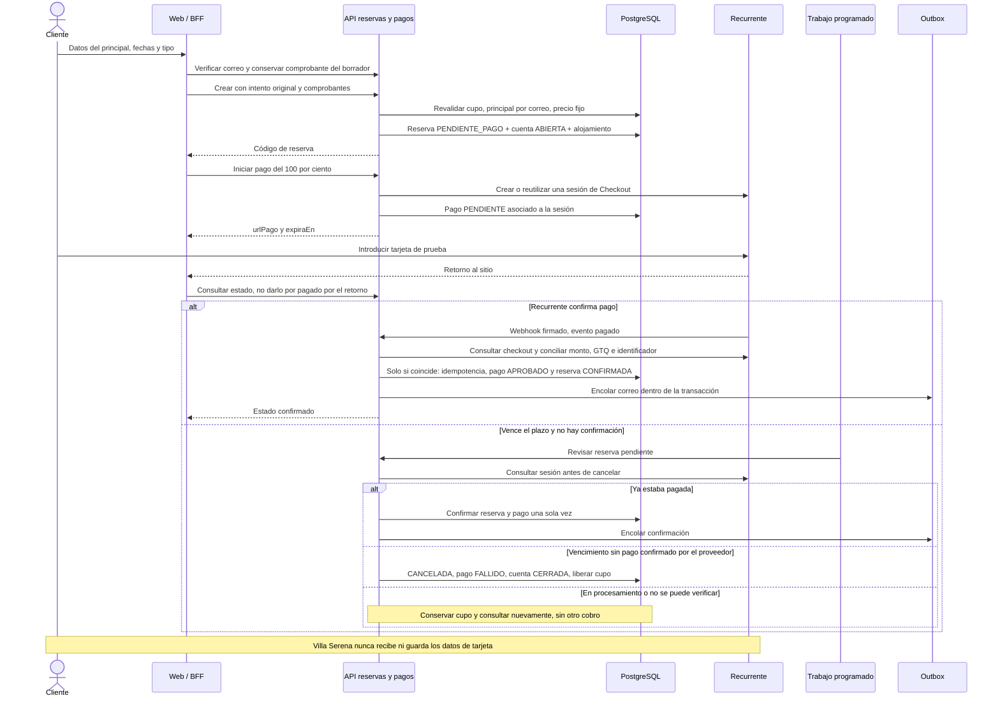

# 06 — Secuencia: reserva web, Recurrente y vencimiento

> Reconciliación 22/10/2026: [flujos y decisiones actuales](../../02-producto/reconciliacion-frontend-20261022.md). El nombre histórico del archivo se conserva. El portal web complementa Android; el retorno no confirma pagos y subir documentos no realiza check-in.

**Vista:** Secuencia · **Alcance del plan:** Hito.

Pagar y volver al sitio no equivale a confirmar: decide el webhook o la conciliación del API.

## Reglas y límites

- Solo se continúa el checkout abierto cuando el backend autoriza `CONTINUAR` y proporciona su enlace. Iniciar o reintentar requiere `INICIAR`/`REINTENTAR`; procesamiento, confirmación pendiente o incertidumbre obligan a esperar y consultar el estado, sin crear otro cobro.
- Al cumplirse el plazo de 30 minutos, el backend consulta y concilia el estado: confirma si el pago está aprobado y solo cancela tras comprobar el vencimiento sin pago. Si hay procesamiento o no se puede verificar, conserva el cupo y reintenta la consulta; el plazo por sí solo no acredita cancelación.

## Referencias

- [07 R1,R4,R5,P1–P3](../maquinas-de-estados.md#3-reserva)
- [10 RN-PAG-001–006](../../02-producto/reglas-de-negocio.md#6-pagos-y-cuenta--rn-pag)
- [12 UC-02,05,15](../../02-producto/casos-de-uso.md#uc-05--procesar-pago-en-línea)

**Historias vinculadas:** `HU-HUE-05`, `HU-HUE-06`, `HU-HUE-07`.

[Índice de diagramas](README.md) · [Cobertura de historias](COBERTURA.md) · [Anterior](05-actividad-disponibilidad-y-tarifa.md) · [Siguiente](07-secuencia-reserva-de-canal-simulado.md)
