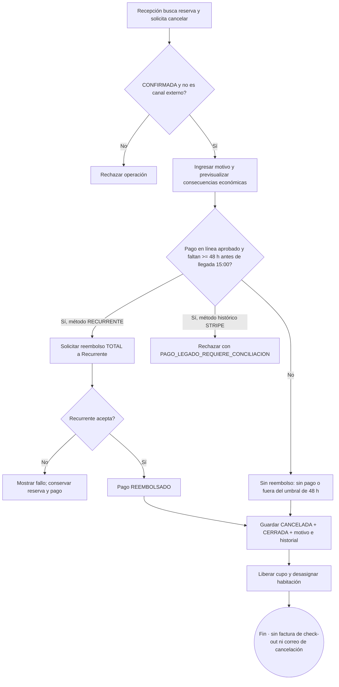

# 16 — Actividad: cancelar reserva y reembolsar

> Reconciliación 22/10/2026: [flujos y decisiones actuales](../../02-producto/reconciliacion-frontend-20261022.md). La pasarela activa es **Recurrente** (`RECURRENTE`); los pagos históricos `STRIPE` requieren conciliación (`PAGO_LEGADO_REQUIERE_CONCILIACION`) y no se reembolsan por el proveedor nuevo.

**Vista:** Actividad · **Alcance del plan:** Hito.

Recepción cancela solo `CONFIRMADA` de origen directo; canal permanece fuera de esta operación.

## Reglas y límites

- El plazo de **48 horas antes de las 15:00 del día de llegada** se evalúa en el momento en que Recepción ejecuta la cancelación, no cuando el huésped envía un mensaje.
- Si Recurrente rechaza el reembolso o el pago elegible es un registro histórico `STRIPE` (`PAGO_LEGADO_REQUIERE_CONCILIACION`), la reserva no se cancela automáticamente con reembolso. No se envía correo de cancelación.
- No-show no es un estado: «No se presentó» es un motivo de cancelación manual sin reembolso.

## Referencias

- [10 RN-CAN](../../02-producto/reglas-de-negocio.md#7-cancelación--rn-can)
- [07 R7](../maquinas-de-estados.md#33-transiciones)
- [12 UC-10](../../02-producto/casos-de-uso.md#uc-10--cancelar-reserva)

**Historias vinculadas:** `HU-REC-05`.

[Índice de diagramas](README.md) · [Cobertura de historias](COBERTURA.md) · [Anterior](15-secuencia-cuenta-cargos-y-saldo.md) · [Siguiente](17-actividad-decisiones-del-check-out.md)
