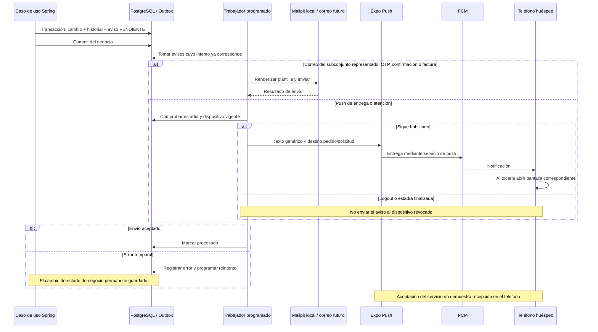

# 20 — Secuencia: Outbox, correos y notificaciones push

> Reconciliación 22/10/2026: [flujos y decisiones actuales](../../02-producto/reconciliacion-frontend-20261022.md). El nombre histórico del archivo se conserva. El portal web complementa Android; el retorno no confirma pagos y subir documentos no realiza check-in.

**Vista:** Secuencia · **Alcance del plan:** Hito.

Persistir un cambio y enviar un aviso son momentos diferentes.

## Reglas y límites

- El diagrama representa el subconjunto OTP de acceso, confirmación y factura, no un inventario exhaustivo: también existen verificación previa del correo y recuperación del personal, con sus integraciones y diferencias contractuales descritas en la [guía del contrato](../contrato-api.md). No se deduce envío real por una plantilla. Dos push del flujo de estadía: pedido entregado y solicitud atendida.
- Push exige EN_ESTADIA y permiso del teléfono; no incluye nombres, datos personales ni montos.
- Development build para push; la vista local Mailpit sirve para comprobar correo. Este atlas no ejecuta esas pruebas.

## Referencias

- [14 AD-12,§5](../arquitectura-sistema.md)
- [07 §§11,12.2,12.3](../maquinas-de-estados.md)
- [10 RN-NOT](../../02-producto/reglas-de-negocio.md)
- [OpenAPI x-push](../../openapi.yaml)

[Índice de diagramas](README.md) · [Cobertura de historias](COBERTURA.md) · [Anterior](19-secuencia-conexiones-y-cuatro-eventos-en-vivo.md) · [Siguiente](21-estados-reserva-cuenta-pago-cargo-y-factura.md)
