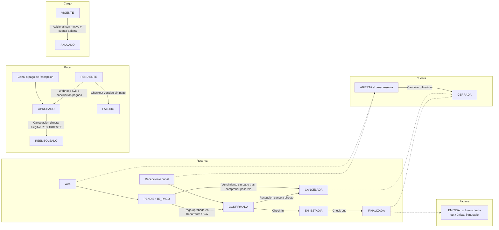

# 21 — Estados: reserva, cuenta, pago, cargo y factura

> Reconciliación 22/10/2026: [flujos y decisiones actuales](../../02-producto/reconciliacion-frontend-20261022.md). La pasarela activa es **Recurrente** (`RECURRENTE`); en el esquema se conserva `STRIPE` por compatibilidad histórica (`PAGO_LEGADO_REQUIERE_CONCILIACION`).

**Vista:** Estados · **Alcance del plan:** Hito.

Cinco ciclos distintos que se relacionan sin confundirse.

## Reglas y límites

- Reserva cancelada cierra la cuenta tal como está; solo el check-out emite factura.
- `PENDIENTE_PAGO`, `CONFIRMADA` y `EN_ESTADIA` consumen cupo. `CANCELADA` y `FINALIZADA` son finales.
- Un intento rechazado o un error de red del navegador no es `FALLIDO`: el pago permanece `PENDIENTE` y `ConsultaProcesoPago` determina `accionPago` (`INICIAR`, `CONTINUAR`, `ESPERAR`, `REINTENTAR` o `NINGUNA`) hasta su confirmación o vencimiento.

## Referencias

- [07 §§3,5](../maquinas-de-estados.md)
- [10 RN-PAG,RN-CAN,RN-FAC](../../02-producto/reglas-de-negocio.md)

[Índice de diagramas](README.md) · [Cobertura de historias](COBERTURA.md) · [Anterior](20-secuencia-outbox-correos-y-notificaciones-push.md) · [Siguiente](22-estados-ocupacion-y-condicion-de-habitacion.md)
