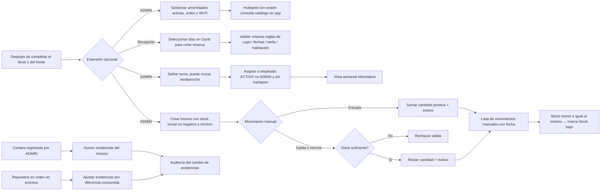

# 25 — Actividad: las cinco historias opcionales

**Vista:** Actividad · **Alcance del plan:** Nivel 2.

Extensiones documentadas, independientes del flujo obligatorio del hito.

## Reglas y límites

- Inventario compartido con compras y repuestos. Pedidos, limpieza y solicitudes no descuentan automáticamente. Compras y repuestos no crean movimientos en la lista manual; el responsable queda en auditoría. Véase [contrato de inventario](../inventario-contrato.md).
- Turnos informativos: no condicionan autenticación ni acceso al sistema.
- Amenidades y Wi-Fi son visibles a cualquier huésped con sesión, sin depender de EN_ESTADIA.

## Referencias

- [Reglas de negocio: RN-INV, RN-TUR, RN-APP-012 y RN-RES-025](../../02-producto/reglas-de-negocio.md)
- [Roadmap por versiones](../../01-metodologia/roadmap-versiones.md)
- [Alcance y decisiones](../../02-producto/alcance-y-decisiones.md)

**Historias vinculadas:** `HU-HUE-18`, `HU-REC-09`, `HU-ADM-11`, `HU-ADM-12`, `HU-ADM-13`.

[Índice de diagramas](README.md) · [Cobertura de historias](COBERTURA.md) · [Anterior](24-secuencia-administracion-y-configuracion.md) · [Siguiente](26-componentes-despliegue-entrega-y-backups-futuros.md)
