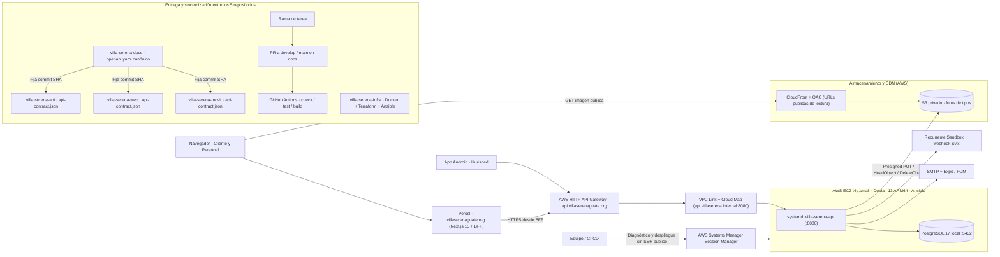

# 26 — Componentes: despliegue en Vercel y AWS, entrega y sincronización del contrato

**Vista:** Componentes · **Alcance del plan:** Despliegue compartido y producción.

Topología implementada en `villa-serena-infra` (`aws/gateway`, `aws/compute`, `aws/storage` y `ansible/`) junto con el flujo de entrega y sincronización de `api-contract.json`.

## Reglas y límites

- Cinco repositorios: `docs`, `infra`, `api`, `web` y `movil`. El contrato canónico vive únicamente en [`villa-serena-docs/openapi.yaml`](../../openapi.yaml) y cada consumidor fija su revisión en `api-contract.json`.
- **Web pública y privada:** desplegada en Vercel (`https://www.villaserenaguate.org`). El navegador habla con el BFF de Next.js y carga imágenes públicas servidas por CloudFront.
- **API e infraestructura AWS:** `api.villaserenaguate.org` entra por AWS HTTP API Gateway + VPC Link + Cloud Map hacia `villa-serena-api.service` (`127.0.0.1:8080`) y PostgreSQL 17 local en EC2 ARM64 administrada por AWS Systems Manager (SSM) sin SSH público expuesto.
- **Imágenes de catálogo:** subida directa por URL prefirmada (`PUT`) a S3 privado y lectura pública vía CloudFront con Origin Access Control (OAC).

## Referencias

- [Arquitectura del sistema §§2, 9 y 10](../arquitectura-sistema.md#2-decisiones-de-arquitectura)
- [Despliegue, modelo de datos y diagnóstico operativo](../../04-guias-y-referencia/despliegue-y-modelo-datos.md)
- [Contrato API y sincronización](../contrato-api.md)
- [Marco de trabajo Scrumban](../../01-metodologia/scrumban.md)
- [CONTRIBUTING §§2,5](../../CONTRIBUTING.md#2-crear-una-rama)

[Índice de diagramas](README.md) · [Cobertura de historias](COBERTURA.md) · [Anterior](25-actividad-las-cinco-historias-opcionales.md)
