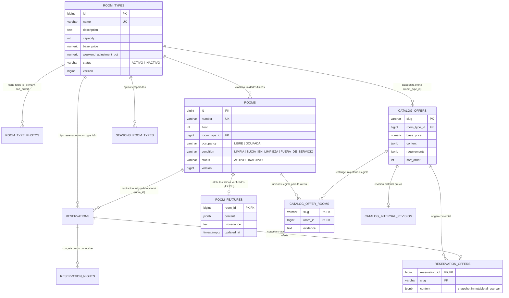

# Manual de Administración: Habitaciones Físicas, Tipos y Ofertas Comerciales

Esta guía define el modelo funcional y técnico que relaciona los **tipos o categorías de habitación**, las **habitaciones físicas** y las **ofertas comerciales del catálogo público**, y precisa qué administra hoy el rol `ADMIN`, cómo se reflejan sus cambios en la web pública y en Recepción, y qué trabajo permanece pendiente en `API #82`, `API #83`, `API #84` y `web #69`.

---

## 1. Tres conceptos distintos en el dominio

Para evitar ambigüedades entre el panel de Administración, Recepción y el portal público, la documentación distingue tres niveles que conviven en PostgreSQL y en el contrato OpenAPI:

| Nivel | Tabla principal | Rol en el sistema | Endpoints actuales en `openapi.yaml` |
|---|---|---|---|
| **1. Tipo / categoría base** | `room_types` (+ `room_type_photos`) | Define la categoría operativa del hotel: nombre único, descripción, capacidad máxima, `base_price` por noche, `weekend_adjustment_pct`, fotos y estado (`ACTIVO` / `INACTIVO`). | `GET/POST /api/v1/admin/tipos-habitacion`, `PUT /api/v1/admin/tipos-habitacion/{id}`, `PATCH .../estado`, `PUT .../fotos`, `GET /api/v1/publico/tipos-habitacion`, `GET /api/v1/publico/disponibilidad` |
| **2. Habitación física** | `rooms` (+ `room_features`) | Representa cada unidad física del hotel (`101`, `102`, etc.) con piso, referencia a `room_types`, ocupación (`LIBRE` / `OCUPADA`), condición (`LIMPIA`, `SUCIA`, `EN_LIMPIEZA`, `FUERA_DE_SERVICIO`), estado de catálogo (`ACTIVO` / `INACTIVO`) y atributos físicos verificados (`room_features`). | `GET/POST /api/v1/admin/habitaciones`, `PUT /api/v1/admin/habitaciones/{id}`, `PATCH .../estado`, `GET /api/v1/habitaciones` |
| **3. Oferta comercial** | `catalog_offers` (+ `catalog_offer_rooms`) | Variante comercial publicada en el portal web (`slug`, `room_type_id`, `base_price` propio, `content` JSONB, `requirements` JSONB y lista explícita de habitaciones elegibles en `catalog_offer_rooms`). | `GET /api/v1/publico/ofertas`, `GET /api/v1/publico/ofertas/disponibilidad`, `POST /api/v1/publico/ofertas/{slug}/reservas` |

> **Regla clave de lectura:**  
> Un **tipo de habitación** (`room_types`) agrupa inventario operativo y rige la disponibilidad/tarifa por tipo en Recepción y en `/api/v1/publico/disponibilidad`.  
> Una **oferta comercial** (`catalog_offers`) es una ficha comercial curada que referencia un `room_type_id`, define su propio `base_price` y restringe qué unidades físicas pueden cumplirla mediante `catalog_offer_rooms`.

---

## 2. Modelo de datos y relaciones

El siguiente diagrama muestra las tablas reales definidas en las migraciones Flyway (`V2`, `V14`, `V17`, `V22` y `V24`) y cómo se congela la fotografía histórica al crear una reserva:

---

## 3. Reglas operativas sobre cantidad, precio y publicación

### 3.1 Cantidad de habitaciones vs. disponibilidad
1. **Sin contador manual en `room_types`:** el número total de habitaciones de un tipo no es un campo editable en `room_types`; se deriva siempre de los registros existentes en `rooms` con ese `room_type_id`.
2. **Cuatro cifras distintas que no deben confundirse:**
   - **Habitaciones registradas del tipo:** total de filas en `rooms` para ese `room_type_id` (activas e inactivas).
   - **Habitaciones operativas del tipo:** filas en `rooms` con `status = 'ACTIVO'` y `condition <> 'FUERA_DE_SERVICIO'`. Es la base del cálculo de cupo por noche en `RN-RES-008`.
   - **Habitaciones elegibles de una oferta:** filas asociadas al `slug` en `catalog_offer_rooms` cuya habitación en `rooms` está `ACTIVO` y no `FUERA_DE_SERVICIO`.
   - **Disponibilidad para un rango de fechas (`entrada`, `salida`, `huespedes`):** resultado dinámico por noche tras descontar reservas en `PENDIENTE_PAGO`, `CONFIRMADA` o `EN_ESTADIA` y comprobar en ofertas que al menos una habitación elegible permanezca libre durante toda la estadía.
3. **Efecto de crear una habitación física (`POST /api/v1/admin/habitaciones`):**
   - Nace `LIBRE` + `LIMPIA` + `ACTIVO` y suma de inmediato al cupo operativo de su `room_type_id` en `/api/v1/publico/disponibilidad` y en Recepción (`RN-HAB-011`).
   - **No se agrega sola a ninguna oferta comercial (`catalog_offer_rooms`)** ni crea una oferta nueva: hasta que no exista una operación administrativa que la vincule con su `evidence` y `room_features` (`API #83`), las ofertas de `/api/v1/publico/ofertas` conservan únicamente sus habitaciones elegibles actuales.

### 3.2 Fuente del precio (`room_types.base_price` vs. `catalog_offers.base_price`)
Existen dos fuentes de precio en la base de datos según la vía de consulta o reserva:

| Vía | Fuente del precio por noche | Ajustes de temporada y fin de semana | Qué ocurre hoy cuando `ADMIN` edita `precioBase` en `PUT /api/v1/admin/tipos-habitacion/{id}` |
|---|---|---|---|
| **Por tipo de habitación** (`/api/v1/publico/tipos-habitacion`, `/api/v1/publico/disponibilidad`, Recepción) | `room_types.base_price` | Aplica `seasons.adjustment_pct` y `room_types.weekend_adjustment_pct` (`RN-TAR-001`). | Se actualiza de inmediato para nuevas consultas y reservas por tipo (`RN-TAR-007`). |
| **Por oferta comercial** (`/api/v1/publico/ofertas`, `/api/v1/publico/ofertas/disponibilidad`, `POST /api/v1/publico/ofertas/{slug}/reservas`) | `catalog_offers.base_price` (`price` en catálogo y `precioPorNoche` en disponibilidad) | Precio fijo por noche (`temporada: null`, `finDeSemana: false`). | **No cambia automáticamente**, porque `catalog_offers.base_price` es una columna independiente en `catalog_offers`. La sincronización o edición administrativa de ofertas depende de `API #83`. |

En ambos flujos, al crearse la reserva, los importes por noche quedan congelados en `reservation_nights` y el total en `reservations.total`. Si la reserva provino de una oferta, `reservation_offers` guarda además la fotografía histórica (`content` JSONB) de la oferta en ese instante.

### 3.3 Estado del tipo, elegibilidad (`bookable`) y publicación de ofertas
- **Desactivar un tipo (`PATCH /api/v1/admin/tipos-habitacion/{id}/estado` a `INACTIVO`):**
  - Oculta el tipo en `/api/v1/publico/tipos-habitacion` y en `/api/v1/publico/disponibilidad` (`RN-HAB-010`).
  - En `/api/v1/publico/ofertas`, una oferta cuyo tipo o inventario elegible no permite reserva queda no reservable (`bookable: false`) y no devuelve cupo en `/api/v1/publico/ofertas/disponibilidad`.
- **`bookable` en `/api/v1/publico/ofertas`:**
  - Indica **elegibilidad general** de la oferta (que el tipo esté activo y la oferta tenga inventario elegible configurado), **no** disponibilidad para fechas concretas.
  - La disponibilidad para fechas y huéspedes se determina exclusivamente en `GET /api/v1/publico/ofertas/disponibilidad?entrada=...&salida=...&huespedes=...`.
- **`inventarioCompartido`:**
  - Cuando dos o más ofertas comerciales comparten habitaciones físicas en `catalog_offer_rooms` o el mismo cupo del tipo, la respuesta de disponibilidad incluye el identificador `inventarioCompartido`. Los cupos de ofertas con el mismo `inventarioCompartido` **no se suman entre sí**.

---

## 4. Matriz de estado de implementación y alcance por repositorio

Para evitar que el equipo o los agentes asuman que editar tipos o habitaciones en Administración ya administra las ofertas públicas de la web, esta tabla separa qué está publicado, qué existe solo como trabajo en curso y qué requiere issues propias:

| Componente / Capacidad | `villa-serena-api` (`dev` publicado) | `villa-serena-web` (`main` publicado) | Pendiente / Issues de seguimiento |
|---|---|---|---|
| **CRUD de tipos de habitación (`room_types`) y sus fotos** | Implementado (`GET/POST/PUT /api/v1/admin/tipos-habitacion`, `PATCH .../estado`, `PUT .../fotos`) con auditoría en `administration_audit`. | Pantalla administrativa conectada vía BFF para tipos y subida/asociación de fotos (ver [guía de fotos](fotos-tipos-habitacion.md)). | `API #82`: alinear permisos de lectura o vistas compartidas si Recepción o Administración requieren cruces adicionales sin abrir rutas de otro rol. |
| **CRUD de habitaciones físicas (`rooms`)** | Implementado (`GET/POST/PUT /api/v1/admin/habitaciones`, `PATCH .../estado`), validando unicidad de número y ausencia de reservas activas al cambiar tipo o desactivar (`RN-HAB-007`). | Pantalla administrativa de habitaciones físicas conectada vía BFF. | `web #69`: reflejar con claridad en la UI de Administración la diferencia entre habitación física, tipo operativo y oferta comercial publicada. |
| **Catálogo público y reserva por oferta (`catalog_offers`, `catalog_offer_rooms`, `room_features`)** | Implementado en lectura y reserva pública (`GET /api/v1/publico/ofertas`, `GET /api/v1/publico/ofertas/disponibilidad`, `POST /api/v1/publico/ofertas/{slug}/reservas`). Las ofertas actuales provienen de migraciones/datos de catálogo (`V17`, `V22`, `V24`). | El portal público consume `/api/v1/publico/ofertas` y `/api/v1/publico/ofertas/disponibilidad` como vitrina principal de reserva. | **`API #83` y `web #69`:** aún **no existen endpoints `/api/v1/admin/ofertas`** en `openapi.yaml` ni pantalla ADMIN publicada para crear/editar `catalog_offers`, su `base_price`, `room_features` o `catalog_offer_rooms`. |
| **Sincronización o separación explícita entre `room_types` y `catalog_offers`** | `room_types.base_price` y `catalog_offers.base_price` viven separados; insertar en `rooms` no inserta en `catalog_offer_rooms`. | Si `ADMIN` cambia el precio de un tipo o agrega una habitación en el panel, la vitrina de ofertas públicas no cambia su precio fijo ni sus habitaciones elegibles hasta que se administre la oferta. | **`API #83`:** definir e implementar el contrato administrativo de ofertas y vínculo de habitaciones elegibles. **`API #84`:** pruebas de regresión de disponibilidad/catálogo entre tipos y ofertas. |

> **Nota sobre trabajo local no publicado:** cualquier ajuste en ramas locales o worktrees de `villa-serena-api` o `villa-serena-web` que aún no esté integrado en `dev`/`main` ni fijado en `api-contract.json` no se considera parte del comportamiento desplegado. Antes de exponer controles de edición de ofertas en la web, debe aprobarse su contrato en `openapi.yaml` y completarse `API #83`.

---

## 5. Criterios de verificación

Para comprobar el comportamiento actual y validar futuras entregas de `API #82`, `API #83`, `API #84` y `web #69`:

1. **Tipos y disponibilidad por tipo (`HU-ADM-03`):**
   - Editar `precioBase` o `capacidad` con `PUT /api/v1/admin/tipos-habitacion/{id}` y verificar que `GET /api/v1/publico/tipos-habitacion` y `GET /api/v1/publico/disponibilidad` reflejan el nuevo valor en reservas nuevas sin alterar `reservation_nights` existentes.
   - Desactivar un tipo con `PATCH /api/v1/admin/tipos-habitacion/{id}/estado` (`{"estado":"INACTIVO"}`) y comprobar que desaparece de `/api/v1/publico/tipos-habitacion` y no ofrece cupo en `/api/v1/publico/disponibilidad`.
2. **Habitaciones físicas (`HU-ADM-04`):**
   - Crear una habitación con `POST /api/v1/admin/habitaciones` en un tipo `ACTIVO`: verificar que nace `LIBRE` + `LIMPIA` + `ACTIVO` y aumenta en 1 el cupo del tipo en `/api/v1/publico/disponibilidad`.
   - Intentar cambiar el tipo o desactivar una habitación con reserva `PENDIENTE_PAGO`, `CONFIRMADA` o `EN_ESTADIA` asignada y verificar que el API responde `409 Conflict` (`RN-HAB-007`).
3. **Ofertas comerciales (`/api/v1/publico/ofertas`):**
   - Verificar que `GET /api/v1/publico/ofertas` devuelve cada oferta con su `slug`, `apiTypeId`, `price` (`catalog_offers.base_price`) y `bookable` sin publicar notas internas (`pendingFeatures`).
   - Verificar que `GET /api/v1/publico/ofertas/disponibilidad` exige tanto cupo en el `room_type_id` como al menos una habitación elegible en `catalog_offer_rooms` libre durante todas las noches del rango, e informa `inventarioCompartido` cuando aplica.
