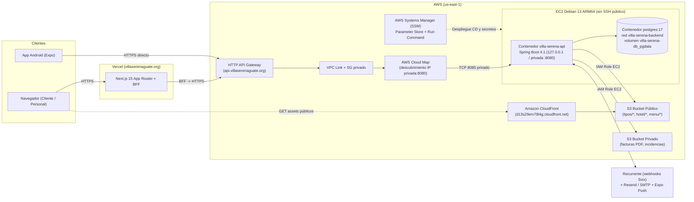

# Guía de Despliegue (Vercel + AWS), Modelo de Datos en Inglés y Diagnóstico Operativo

Este documento consolida la arquitectura real desplegada de **Villa Serena**, la separación entre los perfiles `local`, `dev` y `prod`, el esquema relacional en inglés versionado por Flyway y el procedimiento seguro de diagnóstico ante errores `503` en el API público.

---

## 1. Topología real de despliegue (Vercel + AWS)

En lugar de una única VPS con Cloudflare Tunnel para todos los servicios, el entorno desplegado separa el frontend/BFF y el backend en infraestructura administrada:



### Componentes clave de producción (`prod`)
1. **Web y BFF en Vercel (`https://villaserenaguate.org`):** ejecuta `villa-serena-web` (Next.js 15). Conserva los JWT del personal en cookies `httpOnly` y se comunica con el backend a través de `API_URL=https://api.villaserenaguate.org`.
2. **Pasarela HTTP en AWS (`https://api.villaserenaguate.org`):** provista por `aws/gateway` en `villa-serena-infra` mediante **AWS HTTP API Gateway** (`$default`), un **VPC Link** y **AWS Cloud Map** apuntando a la IPv4 privada de la instancia EC2 en el puerto `8080`.
   - El Security Group de EC2 solo acepta tráfico en `8080` desde el Security Group del VPC Link (nunca desde Internet).
   - **Limitación conocida del HTTP API Gateway:** la integración HTTP proxy actual no transporta WebSockets (`ws://` / `wss://`) de forma transparente; véase `villa-serena-infra/aws/gateway/README.md`.
3. **Host EC2 Debian 13 ARM64 (`aws/compute` + `ansible`):**
   - Configurado mediante Ansible sobre **AWS Systems Manager (SSM)**, sin puerto SSH abierto ni llaves SSH.
   - Incluye un archivo swap de `2048 MiB` (`/swapfile`, `vm.swappiness=10`) y Docker Engine + Compose v2.
   - Ejecuta dos proyectos Docker Compose independientes en la red interna `villa-serena-backend`:
     - **`villa-serena-db`** (`/opt/villa-serena/postgres/compose.yml`): `postgres:17` con volumen persistente `villa-serena-db_pgdata`, sin publicar el puerto `5432` al host ni a Internet.
     - **`villa-serena-api`** (`/opt/villa-serena/api/compose.yml`): imagen ARM64 `ghcr.io/villaserenaguatee/villa-serena-api:<sha>` desplegada desde GitHub Actions mediante OIDC + `aws ssm send-command`.
4. **Almacenamiento de objetos por entorno:**
   - **`local`:** adaptador local persistente en PostgreSQL (sin MinIO ni conexión a la nube).
   - **`dev`:** **Cloudflare R2** remoto desde la máquina de desarrollo (MinIO se retiró del flujo activo).
   - **`prod`:** **Amazon S3** con credenciales temporales del rol IAM de EC2 (`STORAGE_ENDPOINT` vacío), usando el bucket privado (`STORAGE_BUCKET_PRIVATE`) para facturas e incidencias con URLs firmadas y el bucket público servido por **CloudFront** (`ARCHIVOS_URL_PUBLICA=https://d13s29erv78l4g.cloudfront.net`) para fotos de catálogo.

---

## 2. Sincronización de `api-contract.json` entre repositorios

El contrato OpenAPI canónico vive únicamente en [`villa-serena-docs/openapi.yaml`](../openapi.yaml). Ningún consumidor guarda copias YAML locales; cada uno fija el commit aprobado en su propio `api-contract.json`:

| Repositorio | Archivo de pin | Comando de verificación / generación |
|---|---|---|
| `villa-serena-web` | `api-contract.json` | `pnpm generate:api` / `pnpm check:api` (actualiza y comprueba `src/lib/api/schema.d.ts`) |
| `villa-serena-api` | `api-contract.json` | `./mvnw -B verify` (exporta `target/openapi-spring.json`) + `pnpm --dir <docs> contract:api --schema target/openapi-spring.json` |
| `villa-serena-movil` | `api-contract.json` (al adoptarse) | `pnpm --dir <docs> contract:types --output <ruta>.d.ts --check` |

Cuando se integra una PR en `villa-serena-docs/main`, los pines de `web` y `api` pueden quedar temporalmente en commits distintos hasta que cada repositorio abra su PR de adopción, actualice el SHA de 40 caracteres en `api-contract.json` y regenere o contraste sus tipos.

---

## 3. Modelo de datos en inglés, perfiles y carga de datos

### 3.1 Esquema Flyway en inglés (`V1` a `V29`)
Todas las migraciones en `villa-serena-api/src/main/resources/db/migration/` versionan **exclusivamente estructura (DDL)** con nombres de tablas, columnas, índices y restricciones en **inglés**, mientras que los valores de dominio y estados conservan los códigos acordados en español (`CONFIRMADA`, `PENDIENTE_PAGO`, `EN_ESTADIA`, `ACTIVO`, `INACTIVO`, `LIBRE`, `OCUPADA`, `LIMPIA`, `SUCIA`, `FUERA_DE_SERVICIO`, etc.):

| Área | Tablas en PostgreSQL (`db/migration`) | Equivalencia en la documentación funcional |
|---|---|---|
| Seguridad y personal | `employees`, `refresh_tokens`, `staff_access_recovery_requests`, `administration_audit` | Empleados, tokens de renovación, recuperación de acceso y auditoría administrativa |
| Huéspedes y reservas | `guests`, `additional_guests`, `reservations`, `reservation_nights`, `reservation_offers`, `reservation_attempts`, `reservation_email_verifications`, `google_reservation_emails` | Huéspedes, reservas, desglose por noche, snapshot de oferta, idempotencia y verificación de correo |
| Catálogo y habitaciones | `hotel_configuration`, `hotel_photos`, `room_types`, `room_type_photos`, `rooms`, `room_features`, `seasons`, `season_room_types`, `catalog_configurations`, `catalog_offers`, `catalog_offer_rooms`, `catalog_internal_revision`, `menu_items`, `articles` | Configuración del hotel, tipos de habitación, habitaciones físicas, atributos, temporadas, ofertas comerciales, menú y artículos |
| Operación de estadía | `room_service_orders`, `room_service_order_items`, `guest_requests`, `guest_request_items`, `maintenance_incidents`, `incident_work_orders`, `stay_messages`, `lost_items`, `lost_item_returns`, `lost_item_delivery_audit`, `operations_records` | Pedidos de Room Service, solicitudes del huésped, incidencias y órdenes de trabajo, objetos perdidos y registros operativos (`gestion/*`) |
| Cuenta, pagos y facturación | `accounts`, `account_charges`, `payments`, `payment_gateway_events`, `invoices`, `invoice_sequence`, `guest_documents` | Cuentas, cargos, pagos (Recurrente y registros históricos), eventos de webhook, facturas y correlativo |
| Canales y sistema | `external_channels`, `push_devices`, `outbox_events`, `state_history`, `local_private_files`, `website_contacts` | Canales externos, dispositivos push, cola transaccional Outbox, historial de estados (`historial_estados`), archivos privados locales y contacto público |

### 3.2 Separación entre esquema, bootstrap y fixtures
- **Perfiles de ejecución:** solo existen `local`, `dev` y `prod` (`test` es exclusivo de JUnit/Testcontainers). El perfil antiguo `demo` y la migración `V6` fueron retirados.
- **Sin seeds automáticos al arrancar:** un arranque limpio deja las tablas de negocio vacías con `/actuator/health` en `UP`.
- **Bootstrap del primer `ADMIN`:** alta opcional controlada por `BOOTSTRAP_ADMIN_ENABLED=true` + `ADMIN_EMAIL`, `ADMIN_NAME`, `ADMIN_PASSWORD` (contraseña temporal de 12 a 72 bytes UTF-8 que obliga a cambio en el primer inicio de sesión). Una vez creada la cuenta y cambiada la contraseña, se vuelve a `BOOTSTRAP_ADMIN_ENABLED=false`.
- **Carga explícita de datos de prueba en `local`/`dev`:** se ejecuta manualmente fuera de Flyway y fuera del JAR mediante `scripts/demo/load-data.sql` sobre una base local vacía. **Nunca se ejecuta en producción.**

---

## 4. Diagnóstico seguro ante errores `503` en `api.villaserenaguate.org`

Cuando `https://api.villaserenaguate.org` responde `503 Service Unavailable` (o el BFF de Vercel reporta fallo al conectar con el API), significa que **API Gateway + VPC Link no logra respuesta TCP en el puerto `8080` de la IP privada registrada en Cloud Map**, o que el contenedor `villa-serena-api` en EC2 está detenido, reiniciándose o sin conexión a `villa-serena-db`.

### 4.1 Reglas de seguridad operativa (obligatorias)
- **Prohibido ejecutar comandos destructivos:** nunca ejecutar `docker compose down -v`, `docker volume rm`, `flyway clean` ni borrar `/opt/villa-serena/postgres` o `villa-serena-db_pgdata`.
- **No exponer puertos públicos:** no abrir `5432` ni `8080` a `0.0.0.0/0` en los Security Groups de EC2.
- **No imprimir secretos:** no volcar el contenido de `/opt/villa-serena/api/.env` ni parámetros `SecureString` de SSM en logs, issues o PR.

### 4.2 Checklist de diagnóstico de solo lectura (vía AWS SSM)
1. **Revisar el último job de `API CD to EC2` en GitHub Actions (`villa-serena-api`):**
   - Confirmar si el paso `Deploy API via SSM Run Command` terminó en `Success` o falló al esperar `/actuator/health`.
2. **Abrir sesión en la instancia EC2 con AWS Systems Manager (Session Manager) y comprobar contenedores y recursos:**
   ```bash
   # 1. Memoria, swap y disco disponibles
   free -h
   swapon --show
   df -h

   # 2. Estado de los contenedores de base de datos y API
   docker ps -a

   # 3. Salud de PostgreSQL en la red interna
   docker inspect villa-serena-db-postgres-1 --format '{{.State.Status}} / {{.State.Health.Status}}'

   # 4. Salud local del API en el puerto 8080 del host
   curl -i http://127.0.0.1:8080/actuator/health

   # 5. Últimas líneas de log del contenedor del API (sin exponer variables de entorno)
   docker compose -p villa-serena-api -f /opt/villa-serena/api/compose.yml logs --tail=120 api
   ```
3. **Interpretar el hallazgo y recuperar el servicio sin perder datos:**
   - **Si `villa-serena-db-postgres-1` está detenido:** levantarlo sin tocar volúmenes con `docker compose -p villa-serena-db -f /opt/villa-serena/postgres/compose.yml up -d`.
   - **Si `villa-serena-api` no está corriendo o falló al arrancar:** revisar el motivo en `logs --tail=120 api` (p. ej. parámetro faltante en SSM bajo `/villa-serena/prod/api/`, falta de memoria o fallo de conexión a `postgres`) y relanzar el despliegue oficial desde el workflow `API CD to EC2` en GitHub Actions o ejecutar `/opt/villa-serena/api/deploy.sh` con la `IMAGE_URI` aprobada.
   - **Si `curl http://127.0.0.1:8080/actuator/health` responde `200 UP` pero `https://api.villaserenaguate.org` devuelve `503`:** verificar que la IPv4 privada actual de la instancia EC2 coincida con la registrada en AWS Cloud Map (`aws/gateway` en `villa-serena-infra`) y que el VPC Link esté `AVAILABLE`.
